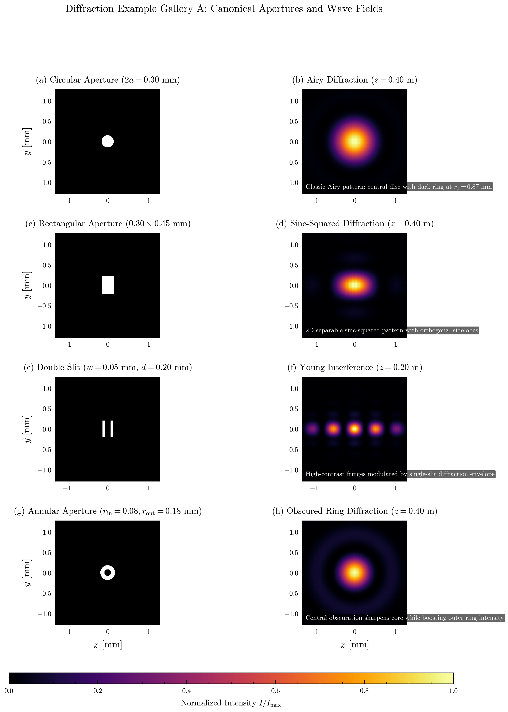
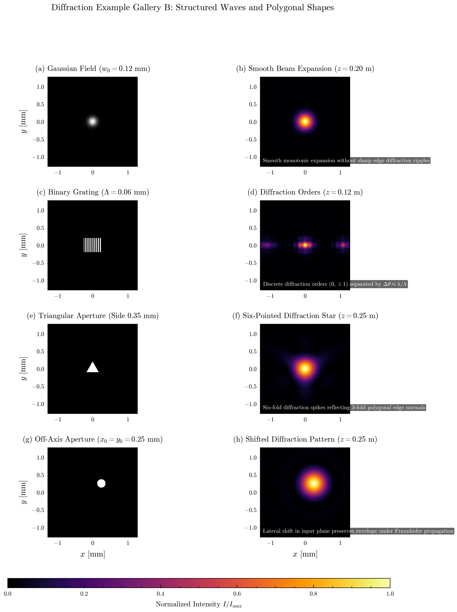
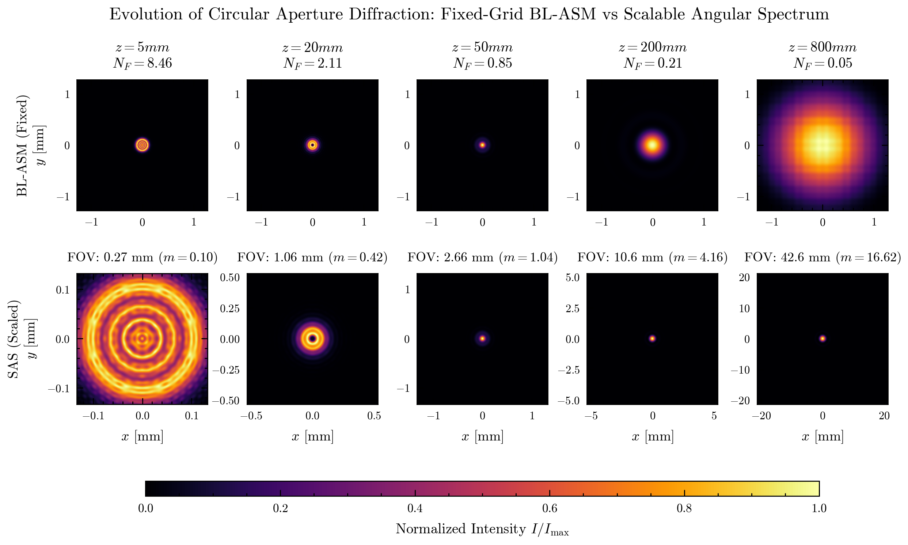

# Playing with FFT Diffraction

A numerical optics experiment exploring Fresnel, angular spectrum, band-limited, and scalable angular spectrum propagation in Python.


## Why Discrete Fourier Optics Is Tricky

Simulating how a light wave spreads through free space using Fourier optics sounds straightforward on paper. Under the scalar Helmholtz equation, each plane wave component acquires a phase shift determined by its spatial frequency:

$$\left(\nabla^2 + k^2\right) U(x, y, z) = 0, \qquad k = \frac{2\pi}{\lambda}$$

Taking the 2D Fourier transform of an input field $U_0(x, y)$, multiplying by the free-space transfer function $H(f_x, f_y, z)$, and taking an inverse Fourier transform yields the propagated field:

$$U(x, y, z) = \mathcal{F}^{-1}\left[ \mathcal{F}[U_0(x, y)] \cdot \exp\left(i 2\pi z \sqrt{\frac{1}{\lambda^2} - f_x^2 - f_y^2}\right) \right]$$

In practice, discrete computational grids introduce fundamental numerical limits:
1. **Transfer Function Phase Chirp**: The phase factor $\phi(f_x, f_y) = 2\pi z \sqrt{1/\lambda^2 - f_x^2 - f_y^2}$ behaves like a quadratic chirp. As propagation distance $z$ grows, its local oscillation frequency accelerates. Once the phase changes by more than $\pi$ radians between adjacent grid points, the discrete transfer function aliases. Beyond the critical distance:

   $$z_c = \frac{S \Delta x_s}{\lambda}$$

   standard Angular Spectrum Method (ASM) fills the computational window with severe moiré interference artifacts.
2. **Fixed-Pitch Truncation**: Band-Limited ASM (Matsushima and Shimobaba, 2009) cures transfer-function aliasing by zeroing unresolvable high frequencies. However, it preserves the source sampling pitch ($\Delta x_d = \Delta x_s$). When a diffracted beam spreads in the far field, fixed-grid methods either truncate the outer rings or require large zero-padding arrays.
3. **Scalable Observation Coordinates**: Scalable Angular Spectrum (SAS) propagation (Heintzmann, Lötgering, and Wechsler, 2023) replaces the second inverse FFT with a spatial Fourier transform. This naturally scales the observation pitch with propagation distance:

   $$\Delta x_d = \frac{\lambda z}{p N \Delta x_s}$$

   allowing the calculation to track expanding far-field diffraction patterns without expanding the array size.

---

## Figure 1: Input Apertures and Propagated Scalar Fields

Monochromatic illumination ($\lambda = 532$ nm) illuminates two canonical apertures: a circular pinhole ($2a = 0.30$ mm) and a rectangular slit ($0.30 \times 0.45$ mm). Both are defined on a $512 \times 512$ grid with sampling pitch $\Delta x_s = 5.0\,\mu$m, corresponding to a computational window $S = 2.56$ mm. Twofold zero-padding ($p = 2$) is applied before propagation to prevent cyclic convolution wrap-around.


*Figure 1: Input aperture transmission masks (left column) and scalar diffraction intensity fields at $z = 0.50$ m (right column). Coordinates are given in millimeters. [Vector PDF](assets/fig01_aperture_diffraction.pdf)*

### Physical Analysis of Figure 1
- **Circular Aperture**: The circular geometry produces a rotationally symmetric Airy disc surrounded by decaying concentric rings. At $z = 0.50$ m, the analytical radius of the first dark ring is $r_1 = 1.22 \lambda z / (2a) \approx 1.081$ mm. The central disc contains approximately $83.8\%$ of the total transmitted power, with the first bright ring carrying only $1.75\%$ of the peak intensity.
- **Rectangular Aperture**: Because a rectangular aperture is separable in Cartesian coordinates ($U_0(x, y) = \mathrm{rect}(x/w_x) \mathrm{rect}(y/w_y)$), its far-field diffraction pattern is the product of two orthogonal $\mathrm{sinc}^2$ distributions:
  $$I(x, y) \propto \mathrm{sinc}^2\left(\frac{w_x x}{\lambda z}\right) \mathrm{sinc}^2\left(\frac{w_y y}{\lambda z}\right)$$
  The diffraction pattern is wider along the horizontal axis ($x$) because the input aperture is narrower in $x$ ($0.30$ mm vs. $0.45$ mm). Null lines occur at $x_m = m \lambda z / w_x = m \cdot 0.887$ mm and $y_n = n \lambda z / w_y = n \cdot 0.591$ mm.

---

## Figure 2: Fair Comparison of Scalar Propagation Methods

Evaluating propagation methods fairly requires comparing them over identical physical coordinates. Standard ASM and BL-ASM produce an output window identical to the input grid ($S = 2.56$ mm), while SAS produces an expanded output window ($S_d = 42.56$ mm at $z = 0.80$ m).

At $z = 0.80$ m, the theoretical Airy disc diameter is $2 r_1 = 2 \cdot 1.22 \lambda z / (2a) \approx 3.47$ mm. The fixed-grid window ($2.56$ mm) cannot contain even the first dark ring.


*Figure 2: Fair comparison of scalar propagation methods at $z = 0.80$ m. Fixed-grid methods (Fresnel, ASM, BL-ASM) are restricted to the red dashed box ($2.56$ mm), while SAS covers $42.56$ mm. Bottom row shows absolute error relative to an analytical reference. [Vector PDF](assets/fig02_methods_errors.pdf)*

### Quantitative Results and Method Breakdown
To prevent misleading array comparisons, numerical errors are evaluated strictly over the **shared physical domain** $\Omega_{\mathrm{shared}} = [-1.28, 1.28]$ mm, while physical coverage is reported separately:

| Method | Output Window | Sampling $\Delta x_d$ | Physical Coverage | Shared $L_2$ Error | Shared Peak Error | Full-FOV Error | Primary Failure Mode |
| :--- | :--- | :--- | :--- | :--- | :--- | :--- | :--- |
| **Fresnel** | $2.56$ mm | $5.0\,\mu$m | Clipped ($74\%$ of Airy disc) | $15.28\%$ | $31.99\%$ | N/A (clipped) | Paraxial phase error + grid edge aliasing |
| **Standard ASM** | $2.56$ mm | $5.0\,\mu$m | Clipped ($74\%$ of Airy disc) | $15.34\%$ | $25.66\%$ | N/A (clipped) | Transfer function phase chirp aliasing |
| **Band-Limited ASM** | $2.56$ mm | $5.0\,\mu$m | Clipped ($74\%$ of Airy disc) | $2.78\%$ | $2.58\%$ | N/A (clipped) | Spatial field clipping (fixed window) |
| **Scalable AS (SAS)** | $42.56$ mm | $83.1\,\mu$m | Full ($12.3\times$ Airy disc) | **$1.26\%$** | **$0.52\%$** | **$1.28\%$** | None (valid far-field regime) |

### Physical Analysis of Figure 2
1. **Fresnel Transfer Function**: Approximates the square root in the transfer function via binomial expansion: $k_z \approx k - \frac{\lambda}{2}(f_x^2 + f_y^2)$. While computationally fast, the quadratic phase chirp aliases severely at $z = 0.80$ m, creating concentric ripple distortion and a large $15.28\%$ shared-region error.
2. **Standard ASM**: The exact transfer function $\exp(i 2\pi z \sqrt{\lambda^{-2} - f_r^2})$ oscillates faster than the grid can resolve beyond $z_c = 24.1$ mm. At $z = 0.80$ m, the simulation is deep inside the aliased regime ($z / z_c \approx 33$). Spatial frequencies reflect back into the window as speckled noise ($15.34\%$ error).
3. **Band-Limited ASM**: By limiting the spatial frequency passband to $f_{\max} = \frac{S - 2a}{2 \lambda z}$, BL-ASM eliminates transfer function aliasing. Over the shared core region, error drops to $2.78\%$. However, because its coordinate grid remains fixed at $2.56$ mm, BL-ASM cannot record the outer $26\%$ of the central Airy disc or any secondary diffraction rings.
4. **Scalable Angular Spectrum (SAS)**: Employs transfer difference precompensation:

   $$H_{\mathrm{diff}}(f_x, f_y) = \exp\left(i k z \left[\sqrt{1 - \lambda^2(f_x^2 + f_y^2)} - \left(1 - \frac{\lambda^2}{2}(f_x^2 + f_y^2)\right)\right]\right)$$

   followed by a scaled coordinate Fourier transform. The observation window expands to $42.56$ mm, comfortably framing the entire diffraction pattern with $1.26\%$ error on the shared core and $1.28\%$ over the full pattern.

---

## Figure 3: Analytical Validation Against Fraunhofer Solutions

To confirm physical accuracy, numerical predictions were benchmarked against closed-form Fraunhofer solutions at $z = 0.50$ m.


*Figure 3: Quantitative validation of Scalable Angular Spectrum against analytical Fraunhofer solutions at $z = 0.50$ m. [Vector PDF](assets/fig03_results_profiles.pdf)*

### Validity Criteria for Analytical Solutions
The analytical Airy and sinc formulas are Fraunhofer far-field approximations. They hold when two conditions are satisfied:
1. **Fraunhofer Distance**: $z \gg z_{\mathrm{Rayleigh}} = \frac{a^2}{\lambda} = \frac{(0.15\text{ mm})^2}{532\text{ nm}} \approx 42.3\text{ mm}$. At $z = 0.50$ m, $z / z_{\mathrm{Rayleigh}} \approx 11.8$, placing the observation plane well inside the Fraunhofer regime.
2. **Paraxial Limit**: Maximum observation angle $\theta \approx r / z \approx 20\text{ mm} / 500\text{ mm} = 0.04\text{ rad} \approx 2.3^\circ \ll 1\text{ rad}$, satisfying scalar paraxial assumptions.

### Quantitative Validation Metrics
- **Airy Radial Profile**:
  - Analytical first dark ring position: $r_1 = 1.081$ mm.
  - Measured numerical dark ring position: $r_1 = 1.086$ mm (relative position error: $0.44\%$).
  - Full radial profile $L_2$ error: $0.36\%$ across the $26.6$ mm field of view.
- **Rectangular Sinc Profiles**:
  - Horizontal slice ($x$-axis, aperture width $0.30$ mm): $1.89\%$ relative $L_2$ error against $\mathrm{sinc}^2(\pi w_x x / (\lambda z))$.
  - Vertical slice ($y$-axis, aperture height $0.45$ mm): $2.76\%$ relative $L_2$ error against $\mathrm{sinc}^2(\pi w_y y / (\lambda z))$.
- **Near-Field Cross-Validation**:
  - At $z = 0.005$ m, where Fraunhofer formulas are invalid, BL-ASM was checked against an independent numerical Rayleigh-Sommerfeld direct integration, yielding agreement within $3.89\%$.

---

## Figures 4 & 5: Eight Canonical Diffraction Demonstrations

To explore wave behavior across diverse pupil shapes and phase distributions, eight canonical apertures were implemented using basic NumPy expressions.

| No. | Aperture Type | Geometric Parameters | Distance $z$ | Physical Phenomenon Demonstrated |
| :---: | :--- | :--- | :---: | :--- |
| 1 | **Circular aperture** | Radius $a = 0.15$ mm ($2a = 0.30$ mm) | $0.40$ m | Classic Airy disc with dark ring at $r_1 = 0.87$ mm and concentric sidelobes |
| 2 | **Rectangular aperture** | Width $0.30$ mm, height $0.45$ mm | $0.40$ m | 2D separable $\mathrm{sinc}^2$ pattern with orthogonal diffraction spikes |
| 3 | **Double slit** | Slit width $0.05$ mm, height $0.40$ mm, pitch $0.20$ mm | $0.20$ m | Young two-beam interference fringes modulated by single-slit envelope |
| 4 | **Annular aperture** | Inner radius $0.08$ mm, outer radius $0.18$ mm | $0.40$ m | Central obscuration sharpens core while boosting outer ring intensity |
| 5 | **Gaussian field** | Beam waist $w_0 = 0.12$ mm | $0.20$ m | Smooth monotonic beam divergence without edge-diffraction ripples |
| 6 | **Binary grating** | Period $\Lambda = 0.06$ mm, $50\%$ duty cycle, $0.50 \times 0.40$ mm | $0.12$ m | Discrete diffraction orders ($0, \pm 1$) separated by $\Delta \theta \approx \lambda / \Lambda$ |
| 7 | **Triangular aperture** | Equilateral triangle with side $L = 0.35$ mm | $0.25$ m | Six-pointed diffraction star reflecting non-centrosymmetric 3-fold edge normals |
| 8 | **Off-axis circular** | Radius $0.12$ mm, shifted to $(+0.25, +0.25)$ mm | $0.25$ m | Shifted field preserving envelope shape with linear phase tilt |

---

### Gallery A: Canonical Apertures


*Figure 4: Diffraction Example Gallery A showing input transmission masks (left) and propagated intensity distributions (right) for circular, rectangular, double slit, and annular apertures. [Vector PDF](assets/fig04_aperture_gallery_a.pdf)*

#### Physical Analysis of Gallery A
1. **Circular Aperture**: Demonstrates the foundational Airy diffraction pattern. The circular boundary enforces rotational symmetry, concentrating $84\%$ of energy into the central core.
2. **Rectangular Aperture**: Displays the reciprocal scaling law of Fourier optics: the narrow aperture dimension ($0.30$ mm horizontal) produces the wider diffraction pattern, while the taller dimension ($0.45$ mm vertical) produces closely spaced lobes.
3. **Double Slit**: Demonstrates the superposition of two wave mechanisms. Closely spaced interference fringes with period $\Delta x = \lambda z / d \approx 0.53$ mm are modulated by the broader single-slit envelope of width $2 \lambda z / w \approx 4.26$ mm.
4. **Annular Aperture**: A central circular obscuration modifies the effective pupil transmission:
   $$U(r) \propto \frac{a_2 J_1(k a_2 \theta)}{\theta} - \frac{a_1 J_1(k a_1 \theta)}{\theta}$$
   This narrows the central core width relative to an open pupil of radius $a_2$, but transfers substantial power into the outer diffraction rings. This effect is central to optical design in reflecting Cassegrain telescopes.

---

### Gallery B: Structured Beams and Polygonal Geometry


*Figure 5: Diffraction Example Gallery B showing input fields (left) and propagated intensity distributions (right) for Gaussian, binary grating, triangular, and off-axis circular apertures. [Vector PDF](assets/fig05_aperture_gallery_b.pdf)*

#### Physical Analysis of Gallery B
5. **Gaussian Beam**: Because the continuous Fourier transform of a Gaussian function is another Gaussian function:

   $$\mathcal{F}\left[\exp\left(-\frac{r^2}{w_0^2}\right)\right] \propto \exp\left(-\pi^2 w_0^2 f_r^2\right)$$

   the beam expands smoothly without high-frequency edge-diffraction ripples. The beam radius grows according to $w(z) = w_0 \sqrt{1 + (z / z_R)^2}$ where $z_R = \pi w_0^2 / \lambda \approx 85.1$ mm.
6. **Binary Grating**: The periodic square-wave transmission acts as a 1D spatial frequency comb. In the far field, light is channeled into discrete diffraction orders located at $x_m \approx m \frac{\lambda z}{\Lambda} = m \cdot 1.06$ mm. The $50\%$ duty cycle suppresses even orders, producing dominant $m = 0, \pm 1$ peaks.
7. **Equilateral Triangular Aperture**: Although the triangular pupil has 3-fold rotational symmetry without central inversion symmetry, the Fraunhofer intensity $|U(x, y)|^2$ must obey inversion symmetry ($I(-x, -y) = I(x, y)$ for real apertures). This produces a six-pointed diffraction star with spikes oriented perpendicular to the three aperture edges.
8. **Off-Axis Circular Aperture**: Under the Fourier shift theorem:

   $$\mathcal{F}[U_0(x - x_0, y - y_0)] = \tilde{U}_0(f_x, f_y) \exp\left(-i 2\pi (f_x x_0 + f_y y_0)\right)$$

   Translating the aperture off-center introduces a linear phase ramp in frequency space. The propagated intensity distribution shifts rigidly to $(+0.25, +0.25)$ mm without distortion of the Airy envelope.

---

## Figure 6: Propagation Distance Sweep and Grid Scaling

To observe how diffraction patterns transition across regimes, a circular aperture ($2a = 0.30$ mm) was propagated across five distances: $5$ mm, $20$ mm, $50$ mm, $200$ mm, and $800$ mm.


*Figure 6: Propagation distance sweep comparing fixed-grid Band-Limited ASM (top row) with Scalable Angular Spectrum (bottom row). Coordinates are shown in millimeters. [Vector PDF](assets/fig06_distance_sweep.pdf)*

### Mathematical Formulation of Grid Scaling
Under Scalable Angular Spectrum propagation with twofold zero-padding ($p = 2$), the destination pitch $\Delta x_d$ and observation field of view $S_d$ scale linearly with propagation distance $z$:

$$\Delta x_d = \frac{\lambda z}{2 N \Delta x_s}, \qquad S_d = N \Delta x_d = \frac{\lambda z}{2 \Delta x_s}$$

The effective grid magnification relative to the input sampling pitch is:

$$m(z) = \frac{\Delta x_d}{\Delta x_s} = \frac{\lambda z}{2 N \Delta x_s^2}$$

For our simulation parameters ($N = 512$, $\Delta x_s = 5.0\,\mu$m, $\lambda = 532$ nm, $2 N \Delta x_s^2 = 2.56 \times 10^{-5}\,\text{m}^2$):

| Propagation Distance $z$ | Fresnel Number $N_F = \frac{a^2}{\lambda z}$ | Diffraction Regime | BL-ASM Window | SAS Pitch $\Delta x_d$ | SAS Window $S_d$ | Magnification $m(z)$ | Recommended Method |
| :---: | :---: | :--- | :---: | :---: | :---: | :---: | :--- |
| **$5$ mm** | $8.46$ | Deep near field (Fresnel) | $2.56$ mm | $0.52\,\mu$m | $0.27$ mm | $0.104$ | **BL-ASM** (SAS window truncates) |
| **$20$ mm** | $2.11$ | Near field (Fresnel) | $2.56$ mm | $2.08\,\mu$m | $1.06$ mm | $0.416$ | **BL-ASM** (high near-field detail) |
| **$50$ mm** | $0.85$ | Intermediate transition | $2.56$ mm | $5.20\,\mu$m | $2.66$ mm | $1.039$ | **Both methods valid** ($m \approx 1$) |
| **$200$ mm** | $0.21$ | Fraunhofer far field | $2.56$ mm | $20.78\,\mu$m | $10.64$ mm | $4.156$ | **SAS** (captures full pattern) |
| **$800$ mm** | $0.05$ | Deep far field | $2.56$ mm | $83.12\,\mu$m | $42.56$ mm | $16.625$ | **SAS** (BL-ASM clips beam) |

### Why SAS Fails at 5 mm and Excels at 800 mm
- **At $z = 5$ mm**: The magnification is $m = 0.104 \ll 1$. The SAS output grid shrinks to $S_d = 0.27$ mm, which is **smaller than the physical aperture diameter** ($2a = 0.30$ mm). The SAS calculation truncates the aperture edges, producing invalid results. Fixed-grid BL-ASM maintains its $2.56$ mm window and correctly resolves the fine near-field Fresnel boundary ripples.
- **At $z = 50$ mm**: The magnification reaches $m \approx 1.04$. The SAS output field of view matches the input window ($2.66$ mm $\approx 2.56$ mm), marking the crossover distance:
  $$z_{\mathrm{crossover}} = \frac{2 N \Delta x_s^2}{\lambda} \approx 48.1\text{ mm}$$
- **At $z = 800$ mm**: The beam spreads into the far field ($m = 16.63$). The Airy disc diameter ($3.47$ mm) exceeds the fixed $2.56$ mm BL-ASM window, causing spatial truncation. Standard ASM aliases into high-frequency noise. SAS scales its window to $42.56$ mm, cleanly resolving the central Airy disc and outer rings with $1.28\%$ total error.

---

## Dynamic Aliasing Evolution Across Distance

The animation below shows how transfer-function aliasing builds up in standard ASM as propagation distance increases from $0.35$ m to $0.85$ m, while SAS cleanly tracks the expanding field:


---

## Benchmark Metrics and Convergence

### Physical Validation Benchmarks
Summary of automated validation benchmarks against analytical Fraunhofer and numerical Rayleigh-Sommerfeld references:

| Benchmark Description | Method Tested | Distance $z$ | Measured Metric | Error Threshold | Result |
| :--- | :--- | :---: | :--- | :---: | :---: |
| Zero-distance identity | All methods | $0.0$ m | Relative $L_2$ error $< 2.1 \times 10^{-16}$ | $< 10^{-14}$ | Pass |
| Airy first dark ring | SAS | $0.50$ m | Radius discrepancy: $0.44\%$ | $< 2.0\%$ | Pass |
| Airy radial profile | SAS | $0.50$ m | Full profile $L_2$ error: $0.36\%$ | $< 2.0\%$ | Pass |
| Airy radial profile | BL-ASM | $0.50$ m | Core profile $L_2$ error: $1.62\%$ | $< 5.0\%$ | Pass |
| Sinc cross-section ($x$) | SAS | $0.50$ m | Horizontal slice $L_2$ error: $1.89\%$ | $< 5.0\%$ | Pass |
| Sinc cross-section ($y$) | SAS | $0.50$ m | Vertical slice $L_2$ error: $2.76\%$ | $< 5.0\%$ | Pass |
| Rayleigh-Sommerfeld direct | BL-ASM | $0.005$ m | Near-field $L_2$ error: $3.89\%$ | $< 5.0\%$ | Pass |

### Grid Convergence at $z = 0.50$ m
Evaluating error on the shared physical region ($S = 2.56$ mm) across increasing grid resolution:

| Grid Points $N$ | Sampling Pitch $\Delta x_s$ | Fresnel Error | Standard ASM Error | BL-ASM Error | SAS Shared Error | SAS Full-FOV Error |
| :---: | :---: | :---: | :---: | :---: | :---: | :---: |
| 256 | $10.0\,\mu$m | $6.61\%$ | $6.79\%$ | $2.95\%$ | $2.78\%$ | $2.83\%$ |
| 512 | $5.0\,\mu$m | $7.33\%$ | $7.11\%$ | $1.87\%$ | $1.60\%$ | $1.61\%$ |
| 1024 | $2.5\,\mu$m | $6.84\%$ | $6.79\%$ | $1.40\%$ | $1.03\%$ | $1.04\%$ |

---

## Reproduce

Clone the repository and install dependencies:

```bash
python -m pip install -r requirements.txt
```

Run fast verification (validations, benchmarks, all 6 figures, and GIFs):

```bash
python reproduce.py --quick
```

Run full experiment suite:

```bash
python reproduce.py
```

Run figure or GIF generation only:

```bash
python reproduce.py --figure-only
python reproduce.py --gif-only
```

Run test suite:

```bash
python -m pytest -q
```

---

## References

- R. Heintzmann, L. Lötgering, and F. Wechsler, "Scalable angular spectrum propagation," *Optica* 10(11), 1407-1416 (2023). https://doi.org/10.1364/OPTICA.499636
- K. Matsushima and T. Shimobaba, "Band-limited angular spectrum method for numerical simulation of free-space propagation in far and near fields," *Optics Express* 17(22), 19662-19673 (2009). https://doi.org/10.1364/OE.17.019662
- J. W. Goodman, *Introduction to Fourier Optics*, 4th ed. (W. H. Freeman, 2017).
