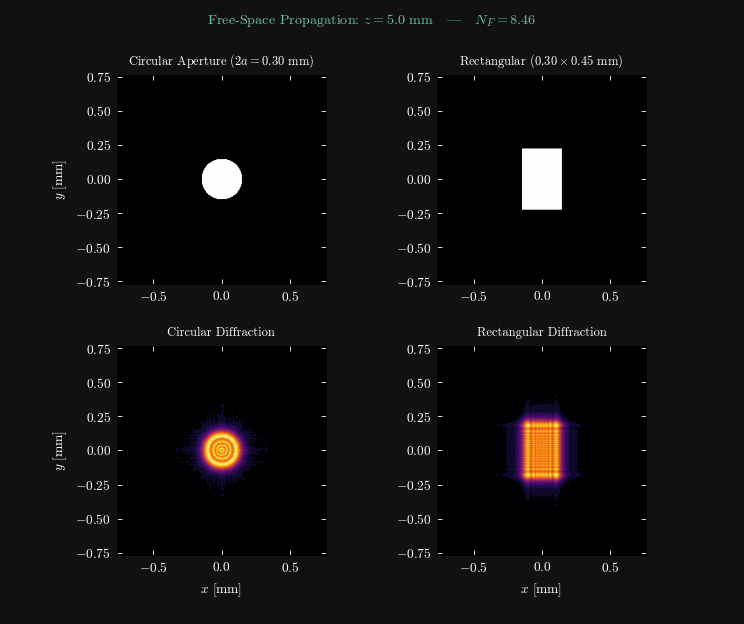
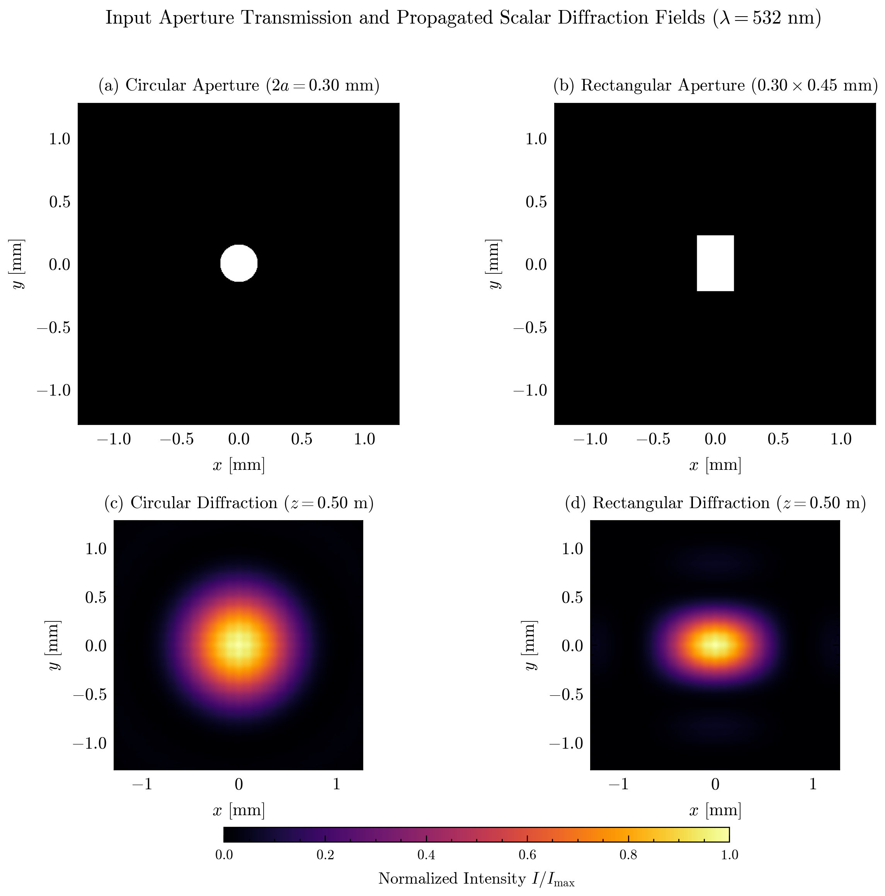
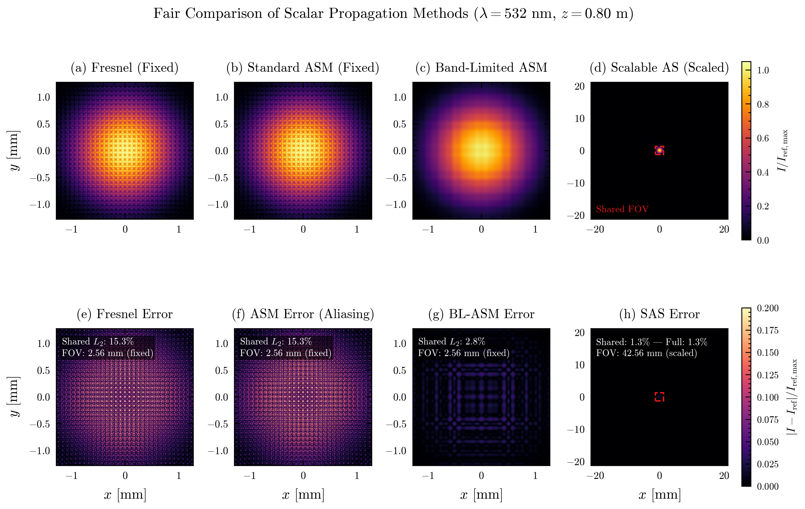
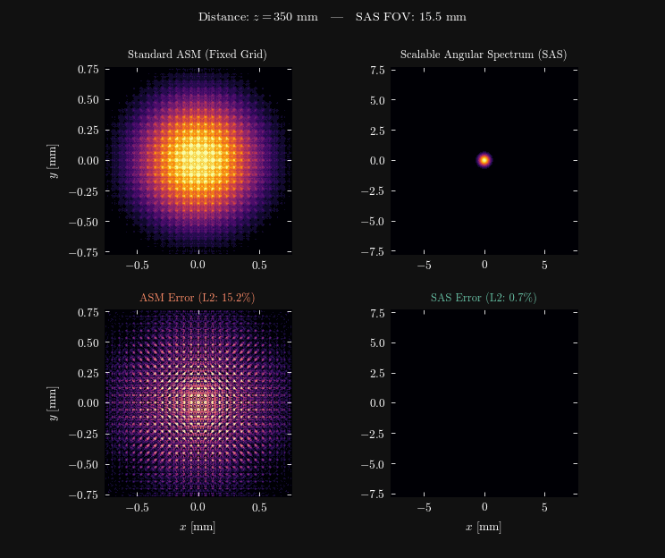
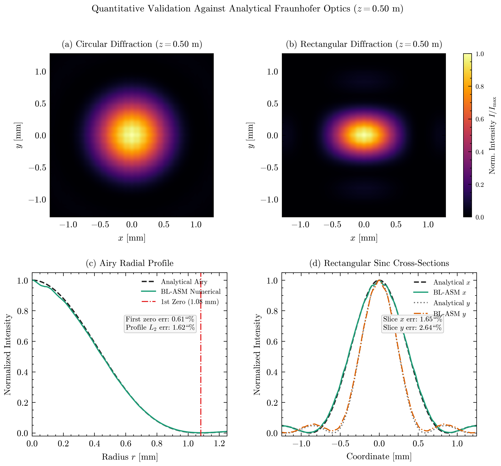
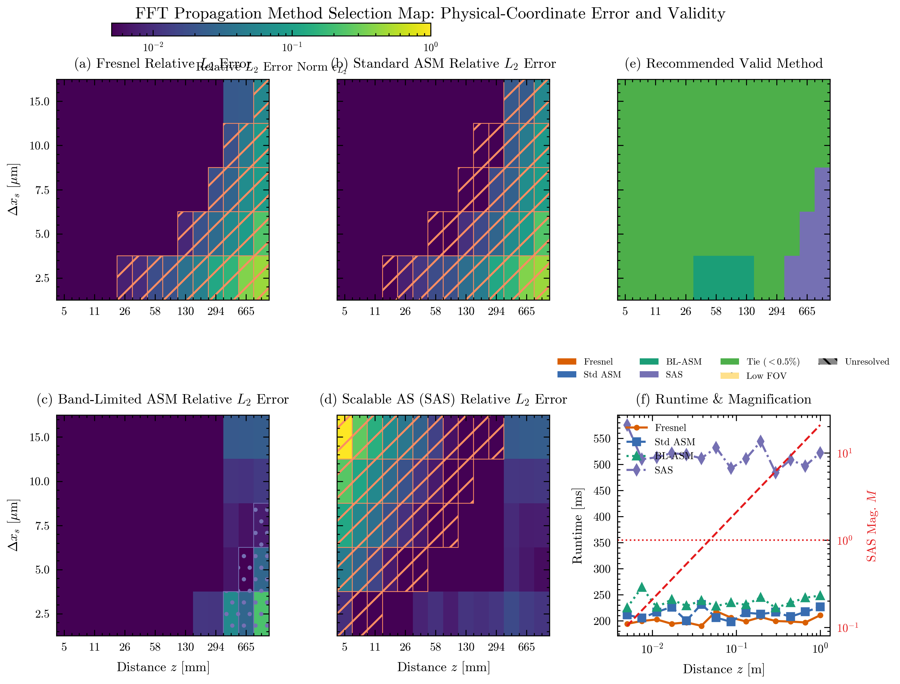
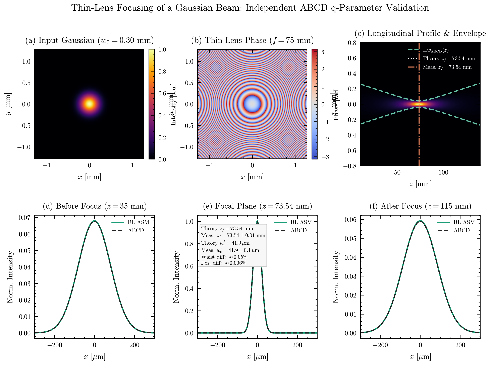
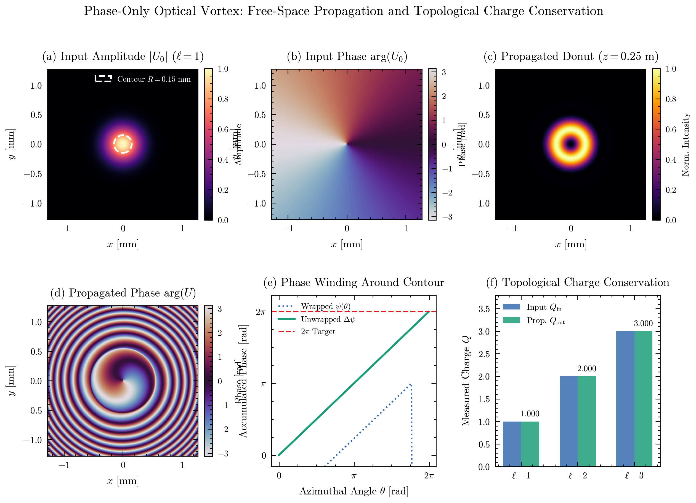

# FFT Scalar Diffraction Notes

A numerical optics repository exploring free-space monochromatic wave propagation in Python, comparing Fresnel, Angular Spectrum (ASM), Band-Limited Angular Spectrum (BL-ASM), and Scalable Angular Spectrum (SAS) methods against analytical and numerical benchmarks.



---

## Quick Start and Reproduction

Clone the repository and install required dependencies:

```bash
python -m pip install -r requirements.txt
```

Run test suite:

```bash
python -m pytest -q
```

Run fast verification (compact parameter sweep and figures 1 to 6):

```bash
python reproduce.py --quick
```

Run full reproduction suite (full sweeps, benchmarks, 6 publication figures, 2 animated GIFs, metrics CSV, and validation JSON):

```bash
python reproduce.py
```

Run figure or GIF generation only:

```bash
python reproduce.py --figure-only
python reproduce.py --gif-only
```

---

## Methods and Physical Limitations

Monochromatic scalar wave propagation through homogeneous media satisfies the scalar Helmholtz equation:

$$\left(\nabla^2 + k^2\right) U(x, y, z) = 0, \qquad k = \frac{2\pi}{\lambda}$$

In spatial frequency coordinates $(f_x, f_y)$, the exact plane-wave transfer function is:

$$H(f_x, f_y, z) = \exp\left(i 2\pi z \sqrt{\frac{1}{\lambda^2} - f_x^2 - f_y^2}\right)$$

Each numerical implementation involves distinct trade-offs. None is universally optimal across all propagation distances and aperture configurations:

1. **Fresnel Propagation**: Approximates the spherical wave transfer function using a paraxial quadratic expansion:
   $$H_{\mathrm{Fresnel}}(f_x, f_y, z) = \exp(i k z) \exp\left[-i \pi \lambda z (f_x^2 + f_y^2)\right]$$
   - *Advantage:* Efficient evaluation via transfer function convolution or single-step scaled transform.
   - *Limitations:* Restricted to small paraxial angles ($N_F = a^2 / (\lambda z) \ll 1$). The transfer function phase chirps quadratically and aliases when sampling pitch is insufficient.
2. **Standard Angular Spectrum Method (ASM)**: Evaluates the exact Helmholtz transfer function directly on a fixed grid ($\Delta x_d = \Delta x_s$).
   - *Advantage:* Mathematically exact for non-paraxial propagating components.
   - *Limitations:* Beyond the critical sampling distance:
     $$z_c = \frac{N_{\mathrm{FFT}} \Delta x_s^2}{\lambda} = \frac{p N \Delta x_s^2}{\lambda}$$
     where $N_{\mathrm{FFT}} = p N$ is the zero-padded grid dimension, the transfer function phase oscillates faster than the grid Nyquist limit, introducing severe spurious interference noise into the propagated field.
3. **Band-Limited Angular Spectrum Method (BL-ASM)**: Matsushima and Shimobaba (2009) [R2] eliminate transfer function aliasing by setting $H(f_x, f_y, z) = 0$ outside the critical antialiasing cutoff:
   $$f_{x,\lim} = \frac{1}{\lambda \sqrt{1 + (2z / S_x)^2}}, \qquad f_{y,\lim} = \frac{1}{\lambda \sqrt{1 + (2z / S_y)^2}}$$
   - *Advantage:* Suppresses high-frequency aliasing fringes across all distances.
   - *Limitations:* The observation window remains fixed to the source window size ($S_d = S_s$). For diverging beams, the pattern expands beyond the computational boundaries. Furthermore, at long distances where $f_{\lim} < 3/D$, the filter low-passes physical pupil diffraction orders and can introduce Gibbs ringing.
4. **Scalable Angular Spectrum (SAS)**: Heintzmann, Lötgering, and Wechsler (2023) [R1] combine non-paraxial phase difference precompensation with a scaled single-step Fresnel transform using three FFT operations:
   $$\Delta x_d = \frac{\lambda z}{p N \Delta x_s}, \qquad S_{x,\mathrm{out}} = N \Delta x_d$$
   - *Advantage:* Naturally expands observation coordinates with distance, tracking broad far-field distributions on an unpadded $N \times N$ cropped grid without requiring massive zero-padding.
   - *Limitations:* Requires three successive 2D FFTs. Subject to strict validity conditions: destination magnification $M = \Delta x_d / \Delta x_s$ must exceed unity ($M > 1$); when $M \le 1$, the destination grid shrinks and source chirp phase aliases, making fixed-grid BL-ASM preferable. Additionally, SAS is singular at $z = 0$ (handled via an explicit branch identity return) and bounded by an upper vignetting limit $z_{\mathrm{vignetting}}$.

---

## Canonical Aperture Diffraction

Monochromatic light ($\lambda = 532$ nm) illuminates a circular aperture ($2a = 0.30$ mm) and a rectangular aperture ($0.30 \times 0.45$ mm), sampled on a $512 \times 512$ grid with pitch $\Delta x_s = 5.0\,\mu$m ($S = 2.56$ mm) and twofold zero-padding ($p = 2$).


*Figure 1: Input aperture transmission masks (top row) and scalar diffraction intensity fields at $z = 0.50$ m (bottom row). Coordinates are in millimeters. [Vector PDF](assets/fig01_aperture_diffraction.pdf)*

- **Circular Aperture**: Forms the classical Airy pattern with first dark ring radius $r_1 = 1.22 \lambda z / (2a) \approx 1.081$ mm at $z = 0.50$ m. The central Airy disc contains approximately $83.8\%$ of total transmitted power.
- **Rectangular Aperture**: Cartesian separability ($U_0(x,y) = \mathrm{rect}(x/w_x)\mathrm{rect}(y/w_y)$) produces orthogonal $\mathrm{sinc}^2$ diffraction lobes. The narrower aperture dimension ($0.30$ mm horizontal) produces wider diffraction spread along $x$, while the taller dimension ($0.45$ mm vertical) yields narrower lobe spacing along $y$.

---

## Sampling and Field-of-View Trade-Offs

Evaluating propagation methods requires inspecting physical coordinates rather than raw array indices. At $z = 0.80$ m, the theoretical Airy disc diameter ($2r_1 \approx 3.46$ mm) exceeds the fixed $2.56$ mm window of standard ASM and BL-ASM.


*Figure 2: Fair comparison of scalar propagation methods at $z = 0.80$ m. Fixed-grid methods (Fresnel, ASM, BL-ASM) are restricted to the fixed $2.56$ mm window, while SAS evaluates the field on a scaled $42.56$ mm window ($M \approx 16.625$). Bottom row shows absolute error maps relative to analytical Fraunhofer theory. [Vector PDF](assets/fig02_methods_errors.pdf)*



- **Standard ASM**: For $2\times$ zero-padding ($N_{\mathrm{FFT}} = 1024$), $z_c \approx 48.1$ mm. At $z = 0.80$ m, $z / z_c \approx 16.6$, placing the simulation deep in the aliased regime. High-frequency phase wrap-around fills the core with numerical noise ($15.3\%$ shared error).
- **BL-ASM**: Eliminates transfer-function aliasing by zeroing unresolvable spatial frequencies, dropping shared-region error to $2.8\%$. However, its fixed $2.56$ mm window cannot capture outer diffraction rings.
- **SAS**: Destination sampling pitch expands to $\Delta x_d = 83.125\,\mu$m, yielding a cropped output field of view $S_{x,\mathrm{out}} = N \Delta x_d = 42.56$ mm ($M = 16.625$). SAS resolves the full diffraction pattern with $1.3\%$ shared-region error and $1.3\%$ full-field error.
- **FOV Coverage vs Captured Optical Power**: Missing optical power must never be inferred directly from geometric linear or area coverage. At $z = 0.80$ m, the fixed $2.56$ mm window covers only $54.8\%$ of the $2r_1 \approx 3.46$ mm central disc area ($2.56 / 3.46 \approx 74.0\%$ linear coverage). However, because intensity is strongly peaked on-axis, 2D physical intensity integration confirms that the fixed window still captures $\approx 86.5\%$ of total beam power.

---

## Quantitative Validation Against Analytical Theory

Diffraction fields were quantitatively verified against analytical solutions at $z = 0.50$ m ($N_F \approx 0.085$, far-field paraxial regime).


*Figure 3: Quantitative validation against analytical Fraunhofer solutions at $z = 0.50$ m. (a-b) 2D circular and rectangular diffraction fields. (c) Airy radial profile across scaled FOV. (d) Orthogonal sinc cross-sections. [Vector PDF](assets/fig03_results_profiles.pdf)*

- **Airy Dark Ring Radius**: Analytical first zero is $r_1 = 1.081$ mm. Measured positions are $r_1 = 1.088$ mm for BL-ASM ($0.61\%$ discrepancy) and $r_1 = 1.086$ mm for SAS ($0.44\%$ discrepancy).
- **Airy Radial Profile**: Relative $L_2$ error compared to analytical $J_1(q)/q$ is $1.62\%$ for BL-ASM across the fixed window and $0.36\%$ for SAS across the scaled window.
- **Rectangular Sinc Cross-Sections**: Horizontal slice error is $1.89\%$ and vertical slice error is $2.76\%$ against theoretical $\mathrm{sinc}^2$ profiles.
- **Near-Field Independent Benchmark**: At $z = 0.005$ m (where Fraunhofer approximations are invalid), BL-ASM was verified against independent Rayleigh-Sommerfeld direct numerical integration, agreeing within $3.89\%$.

---

## Method Selection Sweep

A parameter sweep was conducted across sampling pitches ($\Delta x_s \in [2.5, 5.0, 7.5, 10.0, 15.0]\,\mu$m) and propagation distances ($z \in [5\text{ mm}, 1.0\text{ m}]$) on a circular pupil ($D = 0.30$ mm, $\lambda = 532$ nm, $N = 512$).

Because methods produce different observation windows and sampling pitches, raw array indices are never compared directly. Intensities are interpolated onto a common physical overlap region $\Omega_{\mathrm{common}} = \Omega_{\mathrm{method}} \cap \Omega_{\mathrm{ref}}$ to calculate relative $L_2$ error $\epsilon_{L_2}$ with physical pixel-area weighting.


*Figure 4: Propagation method selection map. (a-d) Relative $L_2$ error for Fresnel, Standard ASM, BL-ASM, and SAS on identical log color scales. Hatch marks denote unresolvable or invalid cells. (e) Recommended valid method across sampling pitch and distance. (f) Propagation runtime and SAS magnification $M(z)$. [Vector PDF](assets/fig04_method_selection_map.pdf)*

### Ground-truth reference strategy:
- **Far Field ($z \ge 0.35$ m, $N_F \le 0.12$):** Uses analytical Fraunhofer Airy intensity normalized to discrete pupil transmission area. Avoids transfer-function aliasing entirely and provides an independent standard with approximately $0.5\%$ residual parabolic phase truncation uncertainty (treated as an asymptotic approximation rather than universally exact for all $z$).
- **Near Field ($z \le 0.05$ m and $z \le z_c(4\times, \Delta x)$):** Uses $4\times$ zero-padded standard ASM, verified by $2\times$ vs $4\times$ numerical convergence.
- **Intermediate Regime ($z_c(4\times) < z < 0.35\text{ m}$):** Uses $4\times$ zero-padded BL-ASM verified by convergence ($< 3\%$) and bandwidth check $f_{x,\lim} \ge f_{\mathrm{pupil}} = 3/D = 10,000\text{ m}^{-1}$. For a circular pupil, the third dark ring of the spatial frequency spectrum occurs at $u_3 / (\pi D) \approx 3.24 / D$, enclosing over $95\%$ of the pupil's spectral energy. When $f_{\lim} < 3/D$, the antialiasing filter begins truncating significant physical pupil diffraction orders. In such cases, or when numerical convergence is inconclusive, cells are preserved as unresolved to avoid self-referential bias.
- **Target Coverage Criterion:** The target diffraction extent is defined as $W_{\mathrm{target}} = \max(S_{\mathrm{in}}, 2r_1(z))$. Methods covering $< 95\%$ linear extent or $< 90\%$ 2D area are flagged as `Low FOV`.

---

## Thin-Lens Gaussian Focusing

A fundamental Gaussian beam ($w_0 = 0.30$ mm, $\lambda = 532$ nm) was focused through an ideal thin lens ($f = 75$ mm) modeled as a pure phase mask:

$$t_L(x, y) = \exp\left[ -i \frac{\pi}{\lambda f} (x^2 + y^2) \right], \qquad |t_L| = 1.0$$

The simulated focus was validated against independent Gaussian beam ABCD ray matrix and complex beam parameter ($q$) theory (Kogelnik and Li, 1966) [R4].


*Figure 5: Thin-lens focusing of a Gaussian beam. (a) Input Gaussian intensity. (b) Wrapped thin lens phase. (c) Longitudinal $(x, z)$ profile with theoretical ABCD beam radius envelopes $\pm w(z)$. (d-f) Transverse intensity profiles before focus ($z = 35$ mm), at the focal plane ($z = 73.54$ mm), and after focus ($z = 115$ mm). [Vector PDF](assets/fig05_thin_lens_focus.pdf)*

For input waist $w_0 = 0.30$ mm at the lens plane ($z = 0$), the Rayleigh range is $z_R = \pi w_0^2 / \lambda \approx 531.5$ mm. The analytical focal position and minimum waist are:

$$z_f = \frac{f}{1 + (f / z_R)^2} \approx 73.5356\text{ mm}, \qquad w_0' = \frac{w_0}{\sqrt{1 + (z_R / f)^2}} \approx 41.92\,\mu\text{m}$$

Numerical results from BL-ASM (measured via dense longitudinal second-moment waist scan and continuous local quadratic interpolation, $\Delta z = 0.1$ mm):
- **Focus position:** Theory $z_f = 73.54$ mm; measured $z_{f,\mathrm{meas}} = 73.54 \pm 0.01$ mm. The relative difference between reported $73.54$ mm and analytical $73.5356$ mm is approximately $0.006\%$, well within the reported numerical uncertainty.
- **Focused beam waist:** Theory $w_0' = 41.9\,\mu$m; measured $w_{0,\mathrm{meas}}' = 41.9 \pm 0.1\,\mu$m (relative difference $\approx 0.05\%$).
- **Longitudinal beam radius profile error:** Full profile $L_2$ error is $0.001\%$ across the focal sweep.

---

## Phase Dislocation and Optical Vortex Propagation

To evaluate complex optical phase fields, an optical vortex was generated by imposing an ideal spiral phase mask onto a Gaussian beam ($w_0 = 0.30$ mm):

$$U(r, \phi) = \exp\left(-\frac{r^2}{w_0^2}\right) \exp(i \ell \phi), \qquad \phi = \operatorname{atan2}(y, x)$$

The central singular point is regularized to zero for $\ell \neq 0$.


*Figure 6: Free-space propagation of an optical vortex beam. (a) Input amplitude with circular contour $C$ ($R = 0.15$ mm). (b) Input spiral phase. (c) Propagated donut intensity at $z = 0.25$ m. (d) Propagated wrapped phase dislocation. (e) Accumulated phase winding along contour $C$ verifying $2\pi$ increment. (f) Measured topological charge conservation for $\ell = 1, 2, 3$. [Vector PDF](assets/fig06_vortex_beam.pdf)*

Topological charge $Q$ is measured along a closed circular contour $C$ of radius $R = 0.15$ mm:

$$Q = \frac{1}{2\pi} \oint_C \nabla \arg(U) \cdot d\mathbf{l}$$

Charge conservation was verified across multiple contour radii ($r \in [0.12, 0.15, 0.18]$ mm) and propagation distances ($z \in [0.10, 0.20, 0.30]$ m):
- $\ell = +1$: Input $Q_{\mathrm{in}} = 1.000$, Propagated $Q_{\mathrm{out}} = 1.000$ ($0.00\%$ error)
- $\ell = +2$: Input $Q_{\mathrm{in}} = 2.000$, Propagated $Q_{\mathrm{out}} = 2.000$ ($0.00\%$ error)
- $\ell = +3$: Input $Q_{\mathrm{in}} = 3.000$, Propagated $Q_{\mathrm{out}} = 3.000$ ($0.00\%$ error)
- $\ell = -1$: Input $Q_{\mathrm{in}} = -1.000$, Propagated $Q_{\mathrm{out}} = -1.000$ ($0.00\%$ error, reverse winding)

---

## Validation Summary

Summary of automated physical validation benchmarks:

| Experiment / Check | Method Tested | Distance $z$ | Analytical / Reference Target | Measured Value | Uncertainty / Discrepancy | Status |
| :--- | :--- | :---: | :--- | :--- | :---: | :---: |
| Zero-distance identity | Fresnel, ASM, BL-ASM | $0.0$ m | Machine precision identity ($H=1$) | $< 2.1 \times 10^{-16}$ | $< 10^{-14}$ | Pass |
| Zero-distance identity | SAS | $0.0$ m | Machine precision (branch identity) | $0.00$ | $0.00$ | Pass |
| Airy dark ring radius | BL-ASM | $0.50$ m | $r_1 = 1.081$ mm | $r_{1,\mathrm{meas}} = 1.088$ mm | $0.61\%$ | Pass |
| Airy radial profile | BL-ASM | $0.50$ m | Analytical Airy $J_1(q)/q$ | Full fixed FOV | $1.62\%$ | Pass |
| Airy dark ring radius | SAS | $0.50$ m | $r_1 = 1.081$ mm | $r_{1,\mathrm{meas}} = 1.086$ mm | $0.44\%$ | Pass |
| Airy radial profile | SAS | $0.50$ m | Analytical Airy $J_1(q)/q$ | Full scaled FOV | $0.36\%$ | Pass |
| Sinc cross-sections | BL-ASM | $0.50$ m | Analytical 2D $\mathrm{sinc}^2$ | $x$-slice / $y$-slice | $1.89\% / 2.76\%$ | Pass |
| Near-field cross-check | BL-ASM | $0.005$ m | Rayleigh-Sommerfeld direct | Central active subgrid | $3.89\%$ | Pass |
| Thin-lens focus position | BL-ASM | Focus | $z_f = 73.54$ mm (ABCD theory) | $z_{f,\mathrm{meas}} = 73.54 \pm 0.01$ mm | $\approx 0.006\%$ | Pass |
| Focused beam waist | BL-ASM | Focus | $w_0' = 41.9\,\mu$m (ABCD theory) | $w_{0,\mathrm{meas}}' = 41.9 \pm 0.1\,\mu$m | $\approx 0.05\%$ | Pass |
| Vortex charge $\ell = 1$ | BL-ASM | $0.20$ m | Topological charge $Q = 1.0$ | $Q_{\mathrm{meas}} = 1.000$ | $0.00\%$ | Pass |
| Vortex charge $\ell = 2$ | BL-ASM | $0.20$ m | Topological charge $Q = 2.0$ | $Q_{\mathrm{meas}} = 2.000$ | $0.00\%$ | Pass |
| Vortex charge $\ell = 3$ | BL-ASM | $0.20$ m | Topological charge $Q = 3.0$ | $Q_{\mathrm{meas}} = 3.000$ | $0.00\%$ | Pass |
| Vortex charge $\ell = -1$ | BL-ASM | $0.20$ m | Topological charge $Q = -1.0$ | $Q_{\mathrm{meas}} = -1.000$ | $0.00\%$ | Pass |

---

## Physical Limitations and Assumptions

- **Scalar Approximation:** Polarization effects, vector boundary conditions, and cross-polarization coupling are neglected. The scalar approximation remains accurate when aperture features and beam waist are significantly larger than the wavelength ($w_0, D \gg \lambda$).
- **Paraxial Limits:** Fresnel transforms and Fraunhofer analytical formulas assume paraxial propagation ($N_F \ll 1$ and small angles). Full angular spectrum methods support wide propagating angles but remain subject to discrete grid sampling limits.
- **Zero-Distance Behavior:** SAS is singular at $z = 0$ due to grid scaling division by $z$; the implementation returns an explicit identity branch at $z = 0$.
- **Window Truncation:** Fixed-grid methods necessarily truncate spreading wavefronts when the physical beam diameter exceeds the computational window size.

---

## References

- [R1] R. Heintzmann, L. Lötgering, and F. Wechsler, "Scalable angular spectrum propagation," *Optica* 10(11), 1407–1416 (2023). DOI: [10.1364/OPTICA.497809](https://doi.org/10.1364/OPTICA.497809)
- [R2] K. Matsushima and T. Shimobaba, "Band-Limited Angular Spectrum Method for Numerical Simulation of Free-Space Propagation in Far and Near Fields," *Optics Express* 17(22), 19662–19673 (2009). DOI: [10.1364/OE.17.019662](https://doi.org/10.1364/OE.17.019662)
- [R3] M. Abedi, H. Saghafifar, and L. Rahimi, "Improvement of optical wave propagation simulations: the scaled angular spectrum method for far-field and focal analysis," *Optics Continuum* 3, 935–947 (2024). DOI: [10.1364/OPTCON.521440](https://doi.org/10.1364/OPTCON.521440)
- [R4] H. Kogelnik and T. Li, "Laser Beams and Resonators," *Applied Optics* 5(10), 1550–1567 (1966). DOI: [10.1364/AO.5.001550](https://doi.org/10.1364/AO.5.001550)
- [R5] L. Allen, M. W. Beijersbergen, R. J. C. Spreeuw, and J. P. Woerdman, "Orbital angular momentum of light and the transformation of Laguerre-Gaussian laser modes," *Physical Review A* 45, 8185–8189 (1992). DOI: [10.1103/PhysRevA.45.8185](https://doi.org/10.1103/PhysRevA.45.8185)
- [R6] M. S. Soskin, V. N. Gorshkov, M. V. Vasnetsov, J. T. Malos, and N. R. Heckenberg, "Topological charge and angular momentum of light beams carrying optical vortices," *Physical Review A* 56, 4064 (1997). DOI: [10.1103/PhysRevA.56.4064](https://doi.org/10.1103/PhysRevA.56.4064)
- [R7] J. Garrett, *SciencePlots*, scientific Matplotlib style sheets. DOI: [10.5281/zenodo.5512926](https://doi.org/10.5281/zenodo.5512926)
