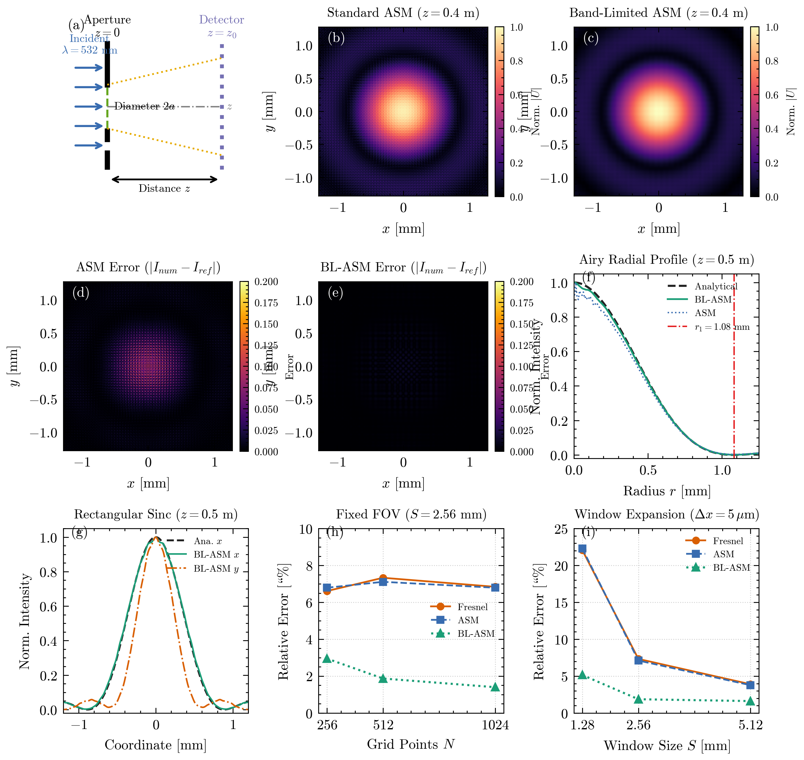

# Playing with FFT Diffraction

Comparing three ways to propagate light numerically.


A small experiment comparing Fresnel, angular spectrum, and band-limited angular spectrum propagation, mostly to see what happens when numerical sampling goes wrong.

## Why I tried this

In optical textbooks, propagating a scalar coherent wave field using Fourier transforms looks deceptively straightforward. The wave equation gives an exact transfer function for each spatial frequency, so a quick pair of 2D FFTs should solve free-space diffraction at any distance.

In practice, sampling constraints turn out to be tricky. At large propagation distances, the quadratic phase chirp of the transfer function oscillates faster than the discrete frequency grid can support. High-frequency phase aliasing kicks in, producing artificial moire patterns and energy wraparound. I wanted to see exactly how and when each method breaks down, and whether the band-limiting technique proposed by Matsushima and Shimobaba (2009) really fixes the problem without introducing worse artifacts.

## The experiment

I implemented three standard FFT-based propagators in Python:

1. **Fresnel transfer function**: The paraxial approximation, replacing the spherical wave dispersion with a parabolic phase kernel:
   $$H_F(f_x, f_y, z) = e^{i k z} \exp\left[-i \pi \lambda z (f_x^2 + f_y^2)\right]$$
2. **Standard Angular Spectrum (ASM)**: The exact dispersion relation for the Helmholtz equation with exponential decay for evanescent modes ($f_x^2 + f_y^2 > 1/\lambda^2$):
   $$H_{AS}(f_x, f_y, z) = \exp\left(i 2\pi z \sqrt{\frac{1}{\lambda^2} - f_x^2 - f_y^2}\right)$$
3. **Band-Limited Angular Spectrum (BL-ASM)**: The Matsushima-Shimobaba formulation, which applies an analytical rectangular band-limiting window to prune spatial frequencies whose local phase gradient exceeds the Nyquist limit of the grid:
   $$f_{x,\text{limit}} = \frac{1}{\lambda \sqrt{1 + \left(\frac{2z}{S_x}\right)^2}}$$

All propagators were evaluated on circular ($r = 150\,\mu$m) and rectangular ($300 \times 450\,\mu$m) apertures under monochromatic illumination ($\lambda = 532$ nm) with double zero-padding to prevent circular convolution artifacts.

## Results



### Benchmark validation

To ensure the numerical engine was sound before comparing failure regimes, each method was cross-checked against independent analytical and numerical benchmarks:

| Benchmark | Test Configuration | Theoretical / Reference Value | Measured Value | Relative Error |
| :--- | :--- | :--- | :--- | :--- |
| Zero-distance identity | Circular, $z = 0.0$ m | Input aperture field | Reconstructed field | $< 10^{-15}$ |
| Airy first dark ring | Circular, $z = 0.50$ m | $r_1 = 1.081$ mm | $r_1 = 1.088$ mm | 0.61% |
| Airy radial profile | Circular, $z = 0.50$ m | $J_1(q)/q$ profile | Azimuthal average | 1.62% |
| Rectangular sinc ($x$) | Rectangular, $z = 0.50$ m | $\text{sinc}^2(W x / \lambda z)$ | Horizontal slice | 1.65% |
| Rectangular sinc ($y$) | Rectangular, $z = 0.50$ m | $\text{sinc}^2(H y / \lambda z)$ | Vertical slice | 2.64% |
| Near-field direct integration | Circular, $z = 0.005$ m | Rayleigh-Sommerfeld integral | BL-ASM field | 3.89% |

### Far-field aliasing ($z = 0.80$ m)

At $z = 0.80$ m ($N = 512$, $\Delta x = 5\,\mu$m), standard ASM suffers severe high-frequency phase aliasing across the observation plane:

| Method | Relative Intensity Error ($L_2$) | Spectral Fraction Retained | Notes |
| :--- | :--- | :--- | :--- |
| Fresnel | 15.28% | 100% | Suffers from paraxial curvature error |
| Standard ASM | 15.34% | 100% | Severe moire fringe aliasing |
| **BL-ASM** | **2.78%** | **0.35%** | **5.5x error reduction, alias-free** |

### Sampling convergence vs window clipping ($z = 0.50$ m)

Increasing grid points $N$ under a fixed observation window ($S = 2.56$ mm) steadily reduces BL-ASM error from 2.95% ($N=256$) to 1.87% ($N=512$) and 1.40% ($N=1024$). Standard ASM and Fresnel remain stuck at ~6.8% because grid refinement alone cannot eliminate the frequency chirp mismatch.

Conversely, with fixed sampling pitch ($\Delta x = 5\,\mu$m), a small grid ($N=256$, $S=1.28$ mm) truncates the outer diffraction rings, producing 5.15% error for BL-ASM and >22% for ASM/Fresnel. Expanding the physical window to $S = 5.12$ mm ($N=1024$) captures these rings, bringing BL-ASM error down to 1.62%.

Computational cost for BL-ASM adds a negligible step (evaluating the coordinate mask), requiring ~1.51 s vs ~1.41 s for standard ASM at $N=1024$ (approx. 7.1% overhead).

## What I learned

1. **Standard ASM is exact in continuous theory, but fragile in discrete implementation.** Beyond the critical sampling distance $z_c = S \Delta x / \lambda$, the transfer function phase oscillates faster than the discrete grid, generating false interference fringes.
2. **Band-limiting acts as a smart low-pass filter.** By removing frequencies that cannot be sampled without aliasing, BL-ASM discards invalid numerical noise while keeping the true physical diffraction envelope.
3. **Resolution cannot substitute for window size.** If the physical window $S$ is too narrow, the outer diffracted sidelobes clip at the borders regardless of how finely the aperture is sampled.

## Reproduce it

Install dependencies:

```bash
pip install -r requirements.txt
```

Run test suite:

```bash
pytest -v
```

Run full experiment suite and regenerate all figures:

```bash
python reproduce.py
```

For quick verification:

```bash
python reproduce.py --quick
```

## References

- K. Matsushima and T. Shimobaba, "Band-limited angular spectrum method for numerical simulation of free-space propagation in far and near fields," *Optics Express* 17(22), 19662 (2009).
- J. W. Goodman, *Introduction to Fourier Optics*, 4th ed., W. H. Freeman (2017).
